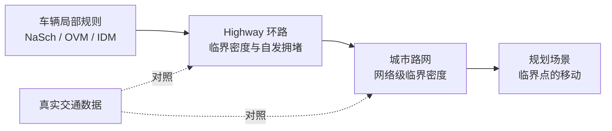
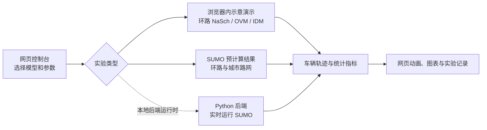

# 项目概述

## 道路网络中的车流拥堵：Agent-Based Modeling 研究

**英文题目：** *Agent-Based Modeling of Traffic Congestion on Road Networks*  
**研究方向：** complex systems、network science、nonequilibrium dynamics、agent-based modeling

---

## 1. 项目摘要

交通拥堵是典型的复杂系统现象。单辆车只根据前车距离、当前速度和信号状态进行局部决策，但大量车辆相互作用后，系统可能出现排队、低速波、拥堵回溢以及整体通行能力下降等宏观现象。

本项目将交通系统表示为由车辆 agent 和道路网络组成的动态系统，并将自由流到拥堵的转变作为非平衡相变进行分析。研究分为两个尺度：

- **Highway（不间断流）：** 在 SUMO 中搭建无信号的单车道环路，比较三种 agent-based 微观交通模型（NaSch、OVM、IDM），扫描车辆密度，估计临界密度，并通过加入单一瓶颈区分密度引起的自发拥堵与瓶颈引起的拥堵。
- **城市路网（间断流）：** 在由 OpenStreetMap 导入、包含交叉口、信号灯和不同限速的真实城区路网上扫描网络密度，估计网络级临界密度，并分析拥堵如何从局部路段连成大范围拥堵区域。

所有正式模拟都在同一个 SUMO 版本中完成：NaSch 和 IDM 使用 SUMO 内置实现，OVM 由本项目用 C++ 实现并加入 SUMO。高速公路与城市路网的结果因此来自同一套实现，可以直接比较。

项目的应用部分聚焦于城市规划：比较道路封闭、新增连接等路网改动如何移动网络的临界密度。真实交通数据用于与模拟得到的基本图和拥堵位置进行对照。最终结果以研究报告、可复现实验代码、统计图表和交互式网页实验环境呈现。

项目不预设某个模型或交通干预一定有效。核心任务是建立可检查的模型，定义可重复的拥堵判据，并用实验数据说明结论成立的条件和局限。

---

## 2. 研究问题

项目围绕以下三个问题展开：

### 2.1 Highway 上的相变与临界密度

在无信号的道路上，自由流到拥堵的转变能否用相变的语言刻画？临界密度是多少？它如何随车辆模型（NaSch、OVM、IDM）、随机性和系统尺寸变化？这种拥堵能否在没有瓶颈的条件下自发出现？它与瓶颈引起的拥堵在形态和统计特征上有何区别？模拟得到的临界密度与真实高速公路数据是否一致？

### 2.2 城市路网的网络级临界点

在包含交叉口、信号灯和不同限速的城市路网中，网络平均密度增加时，是否存在网络级的临界密度，使路网整体通行流量达到峰值后下降？超过临界密度后，拥堵是否从局部路段连成大范围的拥堵区域？路网结构（瓶颈路段、边介数）如何决定临界密度的大小和拥堵最先出现的位置？网络级临界密度与 highway 临界密度有何差异？

### 2.3 城市规划对临界点的影响

道路封闭、新增连接等路网改动，会使网络的临界密度和最大通行流量提高还是降低？增加道路是否一定改善系统（Braess 悖论）？

这三个问题都围绕同一个核心：**临界点在哪里、由什么决定、怎样改变它**，构成从 **单条道路** 到 **城市路网**，再到 **规划应用** 的研究链条。

---

## 3. 研究框架

项目的基本逻辑是：每一步只引入一个新因素，使观察到的变化可以归因于该因素。

1. 用微观规则定义车辆如何运动。
2. 在无信号的环路上确定 highway 的临界密度，并用单一瓶颈区分自发拥堵与瓶颈拥堵。
3. 将车辆放入包含路口、信号和限速的城市路网，以同样的密度扫描方法确定网络级临界密度。
4. 对路网施加规划改动，以临界密度的移动衡量改动的效果。

---

## 4. 车辆模型与模拟工具

### 4.1 Agent-Based Modeling

模型中的 agent 是单辆车。每个车辆状态至少包括：位置、速度、车身长度、前车距离、所在道路、目标位置和出发时间。车辆依据局部信息更新状态，所有车辆的状态共同决定道路和路网的宏观表现。

这种建模方式不直接规定“某个密度一定堵车”，而是观察拥堵是否由个体规则和系统边界条件自发产生。

### 4.2 Nagel–Schreckenberg Model

NaSch 将道路离散为等长 cell，并以离散时间更新车辆速度。基本更新包括：加速、根据前方空位避免追尾、随机减速以及同步移动。

NaSch 的优点是规则简洁、计算速度快，适合验证模型实现、扫描大量密度条件，并展示从自由流到拥堵流的基本图。原始模型见 [Nagel & Schreckenberg, 1992](https://doi.org/10.1051/jp1:1992277)。

**SUMO 中的实现：** 使用 SUMO 内置的 `carFollowModel="NaSch"`。它在 SUMO 的连续空间框架中复现原版的四条规则，按下表设置参数后与原版等价：

| 原版 NaSch | SUMO 中的设置 |
|---|---|
| cell 长度 7.5 m，时间步长 1 s | `accel=7.5`（加速度参数同时充当 cell 长度），`step-length=1` |
| 一辆车占一个 cell | `length=7.5`，`minGap=0`，初始位置按 7.5 m 间隔放置 |
| 所有车辆最大速度相同 | `speedDev=0`，`maxSpeed` 取 7.5 m/s 的整数倍 |
| 随机减速概率 p | `sigma=p`（默认值为 0.5，必须显式设置） |

该模型自 SUMO 1.28.0（2026 年 10 月 8 日发布）起包含在正式版中。

### 4.3 Intelligent Driver Model

IDM 使用连续位置和速度。车辆加速度由期望速度、当前速度、与前车的净间距以及相对速度决定。它能够表达连续跟车、逐渐加速和提前制动等行为。

IDM 的模型方程和交互演示见 [Treiber 的 IDM 说明](https://traffic-simulation.de/info/info_IDM.html)与 [Microsimulation of Traffic Flow](https://traffic-simulation.de/)。

IDM 不会发生追尾，参数具有明确的物理意义。项目使用 SUMO 内置的 `carFollowModel="IDM"`，环路实验和路网实验使用同一套参数；环路实验中设置 `speedDev=0`，排除车辆期望速度差异的影响。

### 4.4 Optimal Velocity Model

OVM 同样使用连续位置和速度。车辆根据与前车的车距确定一个“最优速度” V(Δx)，并以敏感度 a 向该速度调整：dv/dt = a[V(Δx) − v]。原始模型见 [Bando et al., 1995](https://doi.org/10.1103/PhysRevE.51.1035)。

OVM 的特点是存在解析的线性稳定性条件：当均匀车距 h 满足 V′(h) > a/2 时，均匀车流失稳，微小扰动会放大为走走停停波。该条件给出拥堵转变的理论密度范围，可以与模拟得到的阈值直接比较。OVM 在部分参数下可能出现车辆重叠，实现时需要检查。

**SUMO 中的实现：** SUMO 没有内置 OVM。本项目参照 SUMO 内置 IDM 的代码结构，用 C++ 继承 `MSCFModel` 实现 OVM，注册为 `carFollowModel="OVM"`，重新编译后与内置模型以相同方式使用。这是项目中自行实现的模型代码。

### 4.5 三种模型的比较

三种模型都是 agent-based 微观模型，但拥堵的产生机制不同。比较的重点不是让三者得到相同的数值，而是检验拥堵转变、拥堵波和通行能力下降等现象对模型假设的敏感性。

| 模型 | 空间与时间 | 拥堵的来源 | 在比较中的作用 | SUMO 中的实现 |
|---|---|---|---|---|
| **NaSch** | 离散 cell、离散时间 | 随机减速；随机减速概率为 0 时不产生自发拥堵 | 由随机扰动引起的拥堵 | 内置（1.28.0 起） |
| **OVM** | 连续 | 确定性失稳：V′(h) > a/2 时均匀车流不稳定 | 提供理论临界条件，用于验证模拟阈值 | 自行实现（C++） |
| **IDM** | 连续 | 失稳，但保持安全间距、不发生追尾 | 行为最接近现实；城市路网实验的主模型 | 内置 |

为使结果可比，三种模型使用统一的物理单位：NaSch 的 cell 长度取 7.5 m、时间步长取 1 s，所有密度以 veh/km 表示，流量以 veh/h 表示。

### 4.6 模型不只描述“车辆怎么开”

交通仿真由几个互相连接的模型层组成。NaSch、OVM 和 IDM 负责车辆的纵向运动，但完整实验还需要描述道路、信号、出行需求和路线：

| 模型层 | 需要表达的内容 | 本项目的表示方式 |
|---|---|---|
| 车辆行为模型 | 加速、减速、跟车、安全间距、随机波动 | 环路：NaSch、OVM、IDM；路网：IDM（NaSch、OVM 可作为稳健性对照） |
| 道路网络模型 | 路段长度、方向、车道数、限速、道路连接 | 环路：SUMO 中的单车道闭合环路；路网：由 OpenStreetMap 导入的有向加权图；均由 SUMO 执行 |
| 交叉口与信号模型 | 冲突方向、红绿灯相位、绿灯时长、排队空间 | SUMO junction 和 traffic light，采用统一规则生成的固定配时 |
| 出行需求模型 | 谁在路网中、从哪里去哪里 | 按目标网络密度投放固定数量的车辆；车辆到达终点后分配新的随机目的地，使路网内车辆数保持不变 |
| 路线模型 | 车辆选择或遵循哪条道路 | 基于自由流时间的最短路；各场景使用相同的路线规则 |
| 观测模型 | 怎样把车辆状态转换成速度、流量、延误和拥堵 | 统一的统计脚本和拥堵判据 |

因此，模型不是简单地“负责把道路和车辆放进动画”。它们共同决定：车辆如何运动、车辆在哪里相遇、需求如何进入系统，以及哪些宏观指标能够从模拟中测量出来。

### 4.7 综述与可选扩展模型

以下模型进入文献综述；时间允许时可作为扩展，不影响主实验：

| 模型 | 模型尺度 | 建议用途 |
|---|---|---|
| **Cell Transmission Model（CTM）/ LWR** | 用每个道路单元的密度和流量描述交通，不追踪单辆车 | 宏观跨尺度对照：检查微观模型得到的瓶颈通行能力是否与守恒关系一致 |
| **Biham–Middleton–Levine（BML）** | 二维格点上的两类车辆交替移动 | 介绍网络级自组织阻塞，不作为现实城市模型 |

CTM/LWR 不是 agent-based model，其角色是跨尺度对照，而不是替代车辆 agent。

### 4.8 工具分层

| 层次 | 工具 | 职责 |
|---|---|---|
| 微观车辆模型 | [SUMO](https://sumo.dlr.de/docs/)（从源码编译，固定 commit）、C++ | NaSch、IDM 使用 SUMO 内置实现；OVM 用 C++ 实现并编译进 SUMO |
| 宏观基准（可选） | Python、NumPy | 在简单路段或瓶颈上实现 CTM/LWR 的密度—流量守恒 |
| 城市路网获取 | [OSMnx](https://osmnx.readthedocs.io/en/stable/getting-started.html)、SUMO netconvert | 下载 OpenStreetMap 城区路网，转换为 SUMO 路网 |
| 模拟与批量运行 | SUMO、TraCI、Python | 运行环路和城市路网实验；通过 TraCI 维持路网内车辆数；用 Python 脚本批量运行全部参数组合 |
| 网络结构分析 | [NetworkX](https://networkx.org/documentation/stable/tutorial.html) | 计算路径、边介数、网络连接和拥堵区域 |
| 数据分析 | Python、Matplotlib、Pandas | 汇总重复实验、计算指标、生成报告图表 |
| 交互展示 | JavaScript、Canvas、ECharts | 展示、回放和比较 SUMO 结果；浏览器内的环路示意演示 |

所有正式模拟都在同一个 SUMO 版本中完成，环路和城市路网的结果因此可以直接比较。OVM 需要编译进 SUMO，因此项目统一从源码编译 SUMO 1.28.0（已内置 NaSch 和 IDM），并固定所用的代码版本（commit），保证结果可复现。编译和批量运行由一名成员统一负责，避免不同电脑上的版本差异。SUMO 是模拟平台，不作为独立交通模型与 NaSch、OVM、IDM 并列比较。

### 4.9 模型验证

NaSch（新加入 SUMO）和 OVM（自行实现）在正式实验前必须通过以下检验：

| 模型 | 检验 | 通过标准 |
|---|---|---|
| NaSch | 随机减速概率 p = 0 时扫描密度 | 基本图与解析结果一致：以 cell 和时间步为单位，流量 J = min(ρ·vmax, 1 − ρ)，峰值位于 ρ = 1/(vmax + 1) |
| OVM | 在理论失稳条件 V′(h) = a/2 两侧各取若干密度，加入微小扰动 | 稳定一侧扰动衰减，失稳一侧扰动放大为走走停停波 |
| 全部 | 车辆数守恒、速度非负、车辆不重叠 | 每次实验自动检查 |

---

## 5. 三个实验

### 5.0 两种流动与两种拥堵机制

| | 环路实验：Highway | 路网实验与规划实验：城市路网 |
|---|---|---|
| 流动类型 | 不间断流（uninterrupted flow） | 间断流（interrupted flow） |
| 场景 | 单车道环路，代表理想化的一段无信号高速公路 | OpenStreetMap 城区路网，包含交叉口、信号灯和不同限速 |
| 拥堵的主要来源 | 车辆相互作用引起的自发拥堵 | 路口通行能力不足引起的排队、回溢与路网锁死 |
| 临界点的含义 | 单条道路的临界密度 | 整个路网的临界密度 |

交通拥堵至少有两种来源：

- **自发拥堵（spontaneous congestion）：** 道路本身没有瓶颈，车辆密度超过某一范围后，车辆之间的相互作用使均匀车流失稳，形成走走停停波。
- **瓶颈拥堵（bottleneck-induced congestion）：** 路口、信号灯、限速路段等使局部通行能力低于到达流量，车辆在瓶颈上游排队。

城市路网中路段较短、路口密集，拥堵主要由路口瓶颈决定，难以观察到纯粹的自发拥堵。因此，自发拥堵的证据来自环路实验中的无瓶颈环路；环路实验同时加入单一瓶颈作为对照，确认两种机制在模拟中可以区分。下表是根据已有研究和理论预期会看到的特征，是检验时对照的标准，不是本项目的结果；模拟中没有出现的特征，按实际情况报告。

| 看什么 | 自发拥堵（预期） | 瓶颈拥堵（预期） |
|---|---|---|
| 拥堵出现位置 | 随机，不同随机种子下位置不同 | 固定在瓶颈上游 |
| 时空图形态 | 拥堵带整体向后漂移（真实道路上的观测值约 15–20 km/h） | 拥堵带固定在原位；信号瓶颈随周期伸缩 |
| 基本图 | 最大流量取决于车辆规则 | 最大流量降到瓶颈的通行能力，临界密度变低 |

没有瓶颈时车流自发形成拥堵的实验证据见 [Sugiyama et al., 2008, *Traffic jams without bottlenecks*](https://doi.org/10.1088/1367-2630/10/3/033001)。

### 环路实验：Highway 上的相变与临界密度（问题 2.1）

| 项目 | 内容 |
|---|---|
| 目的 | 确定无信号道路上自由流到拥堵的临界密度，检验其对模型、随机性和系统尺寸的依赖，并区分自发拥堵与瓶颈拥堵 |
| 场景 | SUMO 中的单车道闭合环路，车辆不进入或离开系统，无信号 |
| 模型 | NaSch、OVM、IDM（均在 SUMO 中运行，参数设置见 4.2–4.4） |
| 控制变量 | ① **车辆密度**（veh/km）：由低到高扫描，临界附近加密取点 ② **系统尺寸**：至少三种环路长度 ③ **随机性**：NaSch 的随机减速概率 ④ **瓶颈条件**：无瓶颈 / 限速路段（模拟施工区、隧道等造成的通行能力下降）；环路上加入一个红绿灯作为可选的过渡对照 |
| 保持不变 | 每组实验只改变一个控制变量；其余参数、模拟时长、预热时长和随机种子组保持不变 |
| 观测量 | 平均速度、断面流量、序参量（拥堵车辆比例）及其涨落、拥堵位置、拥堵波传播速度 |
| 输出 | ① **基本图**（负责：B）：两张图，横轴都是密度，纵轴分别是平均速度和流量，每张图画出三种模型；流量峰值所在的密度即该模型的临界密度 ② **序参量与涨落**（负责：B）：横轴是密度，纵轴分别是拥堵车辆比例 φ 和涨落 χ，每种环路长度一条曲线；NaSch 另画一组不同随机减速概率的曲线。χ 在某一密度出现峰值，且环路越长峰越尖，说明转变具有相变特征 ③ **OVM 理论对照**（负责：A）：在密度轴上标出满足失稳条件 V′(h) > a/2 的密度区间，检查模拟临界密度是否落在区间内 ④ **有无瓶颈对照**（负责：B）：同一模型、同一组密度分别在有无瓶颈的环路上运行，比较基本图的最大流量和临界密度、时空图中拥堵带是向后漂移还是停在瓶颈上游，以及不同随机种子下的拥堵位置 ⑤ **真实数据对照**（负责：E）：模拟基本图与 PeMS 检测器数据（按单车道换算）画在同一张图上，比较最大流量和临界密度的量级 |
| 判读 | 若三种模型都在某一密度出现流量峰值、序参量上升和涨落峰值，且系统越大转变越陡，说明转变具有相变特征；若有瓶颈时最大流量下降、临界密度提前，且拥堵固定在瓶颈上游，说明该条件下拥堵由瓶颈主导 |

### 路网实验：城市路网的网络级临界点（问题 2.2）

| 项目 | 内容 |
|---|---|
| 目的 | 确定城市路网的网络级临界密度，分析拥堵从局部扩展为大范围区域的过程，以及路网结构对临界点和拥堵位置的影响 |
| 场景 | 由 OpenStreetMap 导入的一片城区路网（先用 4×4 网格验证程序）；交叉口、车道数和限速来自路网数据，信号按统一规则生成固定配时，在本实验中不作为变量 |
| 模型 | SUMO，车辆使用 IDM 跟车规则 |
| 控制变量 | **网络密度**（路网内车辆数 ÷ 车道总长度），由低到高扫描；车辆到达终点后分配新的随机目的地，使每次实验中的网络密度保持不变 |
| 保持不变 | 路网、信号方案、目的地分配规则、路线规则、随机种子组、模拟时长 |
| 观测量 | 网络平均流量与平均速度、停驶车辆比例、各路段速度与排队长度、排队回溢次数、最大拥堵连通区域的规模、是否出现路网锁死 |
| 输出 | ① **宏观基本图**（负责：C）：横轴是网络密度，纵轴是网络平均流量，每个随机种子一组点；流量峰值所在的密度即网络临界密度 ② **最大拥堵连通区域**（负责：C）：横轴是密度，纵轴是最大拥堵连通区域占道路总长度的比例，看它是否在临界密度附近迅速增大 ③ **路段拥堵热图**（负责：C）：低密度、临界附近、高密度三张路网地图，路段按平均速度着色 ④ **边介数与拥堵开始时刻**（负责：C）：散点图，每个点是一条路段，横轴是加权边介数，纵轴是该路段开始拥堵的时刻 ⑤ **路网与高速公路对照**（负责：E）：网络临界密度和环路实验的 highway 临界密度，各附误差范围，画在同一根密度轴上 ⑥ **真实数据对照**（负责：E）：在同一张地图上标出模拟中最常拥堵的路段和 LTA 速度数据中最慢的路段，比较重合程度（城区选在新加坡时适用） |
| 判读 | 若网络流量在某一密度达到峰值后下降，同时最大拥堵区域在该密度附近迅速扩大，说明存在网络级转变；边介数与拥堵开始时刻的相关程度，用于检验网络指标能否预测瓶颈位置 |

根据已有研究，本实验中的拥堵预期以路口瓶颈为主，网络临界密度预期低于 highway 临界密度，两者的差异反映两种拥堵机制的不同。这是检验时对照的预期，不是本项目的结果。宏观基本图的概念与实证见 [Geroliminis & Daganzo, 2008](https://doi.org/10.1016/j.trb.2008.02.002)。

### 规划实验：规划场景对临界点的影响（问题 2.3）

| 项目 | 内容 |
|---|---|
| 目的 | 检验路网改动如何移动网络临界密度，评价规划方案的系统效果 |
| 场景 | 路网实验的城区路网 |
| 对照方案 | **基准：** 路网实验的原始路网 **方案一 道路封闭：** 封闭一条高介数路段，或减少其车道数（模拟施工或道路改造） **方案二 新增连接：** 增加一条连接道路，检验是否出现 Braess 悖论 **方案三（可选）信号配时：** 总周期不变，按方向流量重新分配瓶颈路口的绿灯时间 |
| 控制变量 | 路网方案 × 网络密度（与路网实验使用相同的密度取值） |
| 保持不变 | 除被改动的路段或路口外，其余路网、信号、路线规则、随机种子组与模拟时长 |
| 观测量 | 与路网实验相同 |
| 输出 | ① **宏观基本图叠加**（负责：D）：横轴是网络密度，纵轴是网络流量，基准和各方案画在同一张图上，比较峰值的位置和高度 ② **各方案的临界密度与最大流量**（负责：D）：横轴是方案，纵轴分别是临界密度和最大网络流量，附重复实验的误差范围；新增连接方案的任一项低于基准且超出误差范围，就是 Braess 悖论 ③ **拥堵变化地图**（负责：D）：同一密度下，每条路段在改动方案与基准之间的平均速度之差，画在路网地图上 |
| 判读 | 以临界密度和最大网络流量的变化衡量方案效果：临界密度提高，说明路网能承载更多车辆而不进入拥堵；若新增道路反而使临界密度或最大网络流量下降，则出现了 Braess 悖论 |

### 三个实验能否回答三个研究问题？

每个问题都需要对应的对照条件，不能只运行一条场景：

| 研究问题 | 最低有说服力的实验 | 主要证据 | 容易出现的误区 |
|---|---|---|---|
| Highway 上的临界密度是多少，是否具有相变特征？ | 同一环路、多个密度、三种模型、多种系统尺寸、多个随机种子；有无瓶颈对照 | 基本图、序参量涨落峰值、有限尺寸对比、OVM 理论阈值、真实数据对比 | 只展示一段动画；或在信号路网中看到堵车就解释为密度引起的相变 |
| 城市路网是否存在网络级临界点，由什么决定？ | 真实城区路网上扫描网络密度，多个随机种子 | 宏观基本图峰值、拥堵连通区域规模、边介数与拥堵位置的关系 | 只扫描进入需求而不控制路网内车辆数，无法得到网络密度；只用规则网格，无法代表城市 |
| 规划改动如何移动临界点？ | 相同密度取值和随机种子下比较基准与改动方案 | 临界密度和最大网络流量的变化及误差范围 | 只在单一密度下比较，或只展示产生改善的方案 |

环路实验确立 highway 上的相变特征并区分两种拥堵来源；路网实验将同一套密度扫描方法推广到城市路网；规划实验用临界点的移动评价规划方案。

---

## 6. 临界点分析

临界密度指：随着密度增加，系统从自由流转向拥堵的密度。本项目借用统计物理中分析相变的方法估计临界密度：

| 分析量 | 定义 | 在临界点附近的表现 |
|---|---|---|
| 序参量 | 拥堵车辆比例（速度低于阈值的车辆占比） | 自由流中接近 0，超过临界密度后迅速上升 |
| 涨落 | 序参量或流量在时间上的方差 | 在临界点附近出现峰值 |
| 有限尺寸效应 | 在不同系统尺寸下重复同一扫描 | 系统越大，转变越陡，峰值位置趋于稳定 |
| 弛豫时间（可选） | 系统从初始状态进入稳态所需的时间 | 在临界点附近变长（临界慢化） |

有限道路、有限观察时间和随机初态都会带来不确定性。报告以临界密度的估计值和误差范围呈现，并说明结果对拥堵判据和系统尺寸的敏感性，不预先声称得到了严格意义上的相变点。

### 6.1 Highway 判据

- 平均速度是否明显下降；
- 断面流量是否达到峰值后下降；
- 序参量是否迅速上升，其涨落是否出现峰值；
- 时空图中是否出现持续的拥堵区域或反向传播波；
- 对 OVM，模拟临界密度是否落在线性稳定性分析给出的理论失稳范围内；
- 对有瓶颈的环路，拥堵是否固定在瓶颈上游（瓶颈拥堵）或在其他位置向后漂移（自发拥堵）。

### 6.2 城市路网判据

- 网络平均流量是否达到峰值后下降（宏观基本图的峰值）；
- 停驶车辆比例是否持续上升；
- 低速路段是否形成并迅速扩大的连通区域；
- 是否出现车辆长时间无法移动的路网锁死。

候选临界区间首先用较粗的密度网格定位，再在附近增加实验点和随机重复。报告同时给出平均值、重复实验的波动范围、观察时长和判据的敏感性。

---

## 7. Network Science 的核心联系

本项目不是把道路图作为动画背景，而是研究网络结构如何改变动态交通。

### 7.1 道路网络的表示

- 交叉口表示节点。
- 单向路段表示有向边。
- 长度、限速和车道数表示边的属性。
- 自由流行驶时间作为路线计算的边权重。

### 7.2 路径负载与瓶颈

统计模拟中每条路段被多少条车辆路线使用，并与 NetworkX 计算的加权边介数比较。高介数表示许多路径经过该路段，但不自动等于该路段最拥堵；信号、容量和下游回溢也会影响实际排队。

### 7.3 动态拥堵连通性

将持续低速的路段标记为拥堵边，依据道路连接关系识别相邻拥堵路段，统计最大拥堵区域的道路长度比例，并观察它是否在网络临界密度附近急剧增大。该量描述动态低速区域的空间扩展，不等同于随机删除节点意义下的渗流簇。

课程中关于图表示、中心性、连通分量和渗流的概念，为这些分析提供理论语言。交通拥堵具有方向性、容量约束和相互依赖，不能直接套用独立随机渗流的阈值公式。

交通网络与网络临界现象的研究例子见 [Percolation transition in dynamical traffic network with evolving critical bottlenecks](https://doi.org/10.1073/pnas.1419185112)。该论文用于理解研究方向，不要求完整复现。

---

## 8. 数据范围与现实性边界

| 数据 | 用途 | 对应实验 | 不能直接证明什么 |
|---|---|---|---|
| [OpenStreetMap / OSMnx](https://osmnx.readthedocs.io/en/stable/getting-started.html) | 城区路网的拓扑、方向、车道数和限速 | 路网实验、规划实验 | 不提供真实车流 |
| [PeMS](https://pems.dot.ca.gov/) | 高速公路检测器的流量、占有率和速度；绘制真实基本图，估计真实临界密度 | 环路实验 | 数据来自加州高速公路，不代表城市路网 |
| [highD Dataset](https://levelxdata.com/highd-dataset/) | 高速公路车辆轨迹和跟驰间距；检验跟车模型参数的合理范围 | 环路实验 | 观测路段较短，不能直接代表城市路网 |
| [LTA DataMall](https://datamall.lta.gov.sg/content/datamall/en/dynamic-data.html) | 新加坡路段速度；与模拟的拥堵热点位置对比（城区选在新加坡时适用） | 路网实验 | 不能自动校准所有车辆行为 |

城市路网使用真实拓扑，但路网内的车辆数量和目的地是合成设置，因此报告应表述为“在真实拓扑上的合成需求实验”。真实交通数据用于对照基本图形状、临界密度的量级和拥堵位置，不用于逐车校准。PeMS 与 highD 均需注册或申请，数据获取方式需提前确认。

---

## 9. 交互式实验环境

网页是项目的**实验控制台和可视化界面**。环路和城市路网的正式结果都由 SUMO 预先批量计算，随网站一起发布，网页负责选择参数、回放过程和比较结果。此外，网页提供一个在浏览器中实时运行的环路示意演示。

### 9.1 浏览器内的环路示意演示

为了直观展示车辆规则如何产生拥堵，网页用 JavaScript 在浏览器中实时运行一个环路演示，提供模型选择、车辆数量、道路长度、模型参数、扰动、瓶颈开关和模拟时长等控件。改变一个参数，就能立即看到车流从通畅到拥堵的变化。

该演示只用于理解和展示，网页上明确标注为**示意**；报告中的所有数据都来自 SUMO。

### 9.2 正式实验：以 SUMO 结果为准

环路和城市路网的正式实验全部由 SUMO 计算，以保证结果可靠、贴近真实交通，并且两类实验可以直接比较。

网站托管在 GitHub Pages 上，只能提供静态文件，无法运行 Python 或 SUMO。因此 SUMO 实验分两种方式进行：

| 方式 | 做法 | 用途 |
|---|---|---|
| **预计算（主要方式）** | 在本地用 SUMO 批量运行全部实验组合（密度 × 场景或方案 × 随机种子），把结果导出为数据文件，随网站一起发布 | 报告中的正式结果；任何人打开网站即可切换参数、回放过程、比较方案 |
| **本地实时运行（补充）** | 在本地启动 Python 后端，网页把配置发送给后端，后端调用 SUMO 运行并返回结果 | 组内讨论或现场展示时，尝试预计算范围之外的参数 |

随网站发布的数据以汇总结果为主：环路实验的基本图和时空图数据、各路段按时间段统计的速度和流量、网络层面的密度—流量数据点，以及少量代表性运行的车辆轨迹片段，用于回放动画。完整的原始输出另行保存，不随网站发布。

### 9.3 交互探索与正式结果的关系

| 用途 | 环路实验 | 城市路网实验 |
|---|---|---|
| 探索 | 浏览器示意演示中任意调参；SUMO 结果在预计算组合之间切换 | 在预计算的参数组合之间切换；需要新参数时用本地后端运行 |
| 正式结果 | SUMO 批量运行多个随机种子，结果随网站发布 | SUMO 批量运行多个随机种子，结果随网站发布 |

所有正式结果都要保存配置、随机种子、代码版本和输出数据，保证网页显示、报告图表和他人复现使用同一套记录。

建议包含三个视图：

1. **环路实验：** 查看 SUMO 结果中三种模型的基本图、序参量和时空图；旁边的浏览器示意演示用于直观理解。
2. **路网实验：** 选择网络密度，回放 SUMO 结果中各路段的速度变化，查看拥堵区域和宏观基本图。
3. **规划对照：** 选择路网改动方案，与基准路网并排比较 SUMO 得到的宏观基本图和临界密度。

网页采用俯视二维表达即可，不以写实三维建筑为目标。车辆使用简单图形，颜色表示速度；图表中的每个实验点都对应一个可查看的实验记录。

展示形式可以参考 [Traffic Simulation](https://traffic-simulation.de/) 的交通回放和 [ECharts Examples](https://echarts.apache.org/examples/en/index.html) 的交互图表。网页中的数值、单位、参数和实验编号必须与正式实验记录一致。

---

## 10. 预期成果

项目最终形成以下互相对应的成果：

| 成果 | 内容 |
|---|---|
| 研究报告 | 模型综述、路网表示、实验设计、highway 与城市路网的临界点分析、规划应用、讨论与局限 |
| 模拟代码 | SUMO 中的 OVM 实现（C++）、环路与路网场景配置、模型验证测试、批量运行与数据分析脚本、网页示意演示 |
| 实验数据 | 实验设置、随机种子、统计结果和代表性车辆轨迹 |
| 核心图表 | 三模型基本图、序参量与涨落图、有无瓶颈对比图、时空图、宏观基本图、路网热图、规划方案对比图 |
| 交互网页 | SUMO 结果的可视化、回放与比较，环路示意演示，模型和场景切换，结果说明 |
| 展示 slides | 用约 15 分钟讲清研究问题、方法、证据和结论 |

一个合格的结论应同时说明：观察到的现象、对应的实验条件、统计不确定性，以及模型与现实之间的限制。

---

## 11. 一句话总结

本项目通过“**车辆局部规则 → highway 临界密度 → 城市路网临界密度 → 规划改动对临界点的影响**”这一条研究链，分析交通拥堵如何作为非平衡相变从个体相互作用中涌现，区分密度引起的自发拥堵与瓶颈引起的拥堵，并用 network science 的图结构和动态连通性解释拥堵在城市路网中的扩展。
