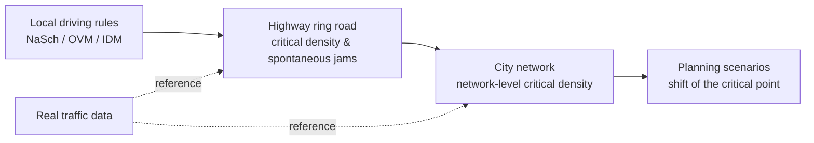
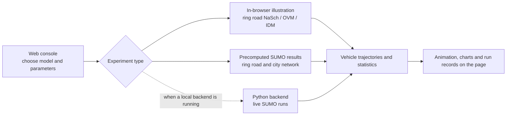

# Project Overview

## Agent-Based Modeling of Traffic Congestion on Road Networks

**Research areas:** complex systems, network science, nonequilibrium dynamics, agent-based modeling

---

## 1. Summary

Traffic congestion is a textbook example of a complex system. Each driver makes purely local decisions based on the gap to the car ahead, their own speed and the state of the traffic light. Yet when many vehicles interact, the system as a whole produces queues, slow-moving waves, spillback and a drop in overall capacity.

This project models traffic as a dynamical system of vehicle agents moving on a road network, and treats the transition from free flow to congestion as a nonequilibrium phase transition. The work covers two scales:

- **Highway (uninterrupted flow):** On a single-lane ring road built in SUMO with no traffic lights, we compare three agent-based microscopic models (NaSch, OVM and IDM), sweep the vehicle density, and estimate the critical density. Adding a single bottleneck to the ring lets us separate congestion that emerges spontaneously from density alone from congestion caused by a bottleneck.
- **City network (interrupted flow):** On a real urban road network imported from OpenStreetMap, complete with intersections, traffic lights and varying speed limits, we sweep the network density, estimate a network-wide critical density, and study how local jams grow into large congested regions.

All formal simulations run on a single SUMO build: NaSch and IDM use SUMO's built-in implementations, and we implement OVM in C++ and add it to SUMO. Highway and city-network results therefore come from the same implementation and can be compared directly.

The application focuses on urban planning: how do changes to the network, such as closing a road or adding a new link, shift the critical density? Real traffic data are used as a reference for the simulated fundamental diagrams and congestion locations. The final deliverables are a research report, reproducible simulation code, figures, and an interactive web-based simulation environment.

We make no prior assumption that any particular model or intervention will work. The core task is to build models that can be checked, define congestion criteria that can be reproduced, and use simulation data to state under what conditions each conclusion holds and where it breaks down.

---

## 2. Research Questions

### 2.1 Phase transition and critical density on a highway

On a road without traffic lights, can the transition from free flow to congestion be described as a phase transition? What is the critical density, and how does it depend on the vehicle model (NaSch, OVM, IDM), the level of randomness and the system size? Can jams form spontaneously without any bottleneck, and how do they differ, in shape and statistics, from jams caused by a bottleneck? Does the simulated critical density agree with real highway data?

### 2.2 Network-level critical point in a city

In an urban network with intersections, traffic lights and mixed speed limits, is there a network-wide critical density beyond which total throughput peaks and then falls? Above that density, do local jams merge into large congested regions? How does the network structure (bottleneck links, edge betweenness) determine the critical density and where congestion first appears? How does the network critical density compare with the highway one?

### 2.3 How urban planning shifts the critical point

Do changes such as road closures or new links raise or lower the network's critical density and maximum throughput? Does adding a road always help, or can it make things worse (Braess's paradox)?

All three questions revolve around the same theme: **where the critical point lies, what determines it, and how it can be moved.** Together they form a progression from **a single road**, to **a city network**, to **a planning application**.

---

## 3. Research Framework

The guiding principle is to introduce one new factor at each step, so that any change in the results can be attributed to that factor.

1. Define how vehicles move using microscopic rules.
2. Find the highway critical density on a ring road without traffic lights, and use a single bottleneck to distinguish spontaneous jams from bottleneck-induced ones.
3. Place vehicles on a city network with intersections, traffic lights and speed limits, and apply the same density-sweep approach to find the network-level critical density.
4. Modify the network according to planning scenarios, and measure each scenario's effect by how much it shifts the critical density.

---

## 4. Vehicle Models and Simulation Tools

### 4.1 Agent-based modeling

Each agent is a single vehicle. Its state includes at least its position, speed, length, gap to the vehicle ahead, current road, destination and departure time. Vehicles update their state using local information only, and the collective state of all vehicles determines the macroscopic behavior of the road or network.

This approach never prescribes that "a given density causes a jam". Instead, it lets us observe whether congestion emerges on its own from individual rules and boundary conditions.

### 4.2 Nagel–Schreckenberg model (NaSch)

NaSch divides the road into cells of equal length and updates vehicle speeds in discrete time steps. Each update consists of four rules: accelerate, slow down to avoid hitting the car ahead, randomly slow down, and move all vehicles simultaneously.

The rules are simple and fast to compute, which makes NaSch well suited to validating the implementation, sweeping many densities, and producing the fundamental diagram that shows the change from free flow to congested flow. Original paper: [Nagel & Schreckenberg, 1992](https://doi.org/10.1051/jp1:1992277).

**Implementation in SUMO:** we use SUMO's built-in `carFollowModel="NaSch"`. It reproduces the four original rules inside SUMO's continuous-space framework and is equivalent to the original model with the following settings:

| Original NaSch | SUMO setting |
|---|---|
| 7.5 m cells, 1 s time step | `accel=7.5` (the acceleration parameter doubles as the cell length), `step-length=1` |
| One vehicle per cell | `length=7.5`, `minGap=0`, initial positions spaced 7.5 m apart |
| Same maximum speed for every vehicle | `speedDev=0`, `maxSpeed` a multiple of 7.5 m/s |
| Random slowdown probability p | `sigma=p` (defaults to 0.5, so it must be set explicitly) |

This model was added to SUMO's development branch in August 2026 and is not yet in the latest release (1.27.1), so the project uses a SUMO build compiled from source (see 4.8).

### 4.3 Intelligent Driver Model (IDM)

IDM uses continuous positions and speeds. A vehicle's acceleration depends on its desired speed, its current speed, the net gap to the vehicle ahead, and the speed difference between the two. It captures smooth car-following, gradual acceleration and anticipatory braking.

The equations and an interactive demo are available in [Treiber's IDM page](https://traffic-simulation.de/info/info_IDM.html) and [Microsimulation of Traffic Flow](https://traffic-simulation.de/).

IDM is collision-free and its parameters have clear physical meaning. We use SUMO's built-in `carFollowModel="IDM"` with the same parameters in the ring-road and city-network experiments. In ring-road runs we set `speedDev=0` to remove differences in desired speed between vehicles.

### 4.4 Optimal Velocity Model (OVM)

OVM also uses continuous positions and speeds. Each vehicle computes an "optimal velocity" V(Δx) from its headway and relaxes towards it with sensitivity a: dv/dt = a[V(Δx) − v]. Original paper: [Bando et al., 1995](https://doi.org/10.1103/PhysRevE.51.1035).

What makes OVM useful here is that its linear stability can be analysed exactly. Uniform flow with headway h becomes unstable when V′(h) > a/2, at which point small perturbations grow into stop-and-go waves. This gives a theoretical density range for the transition that can be compared directly with the simulated threshold. For some parameter choices OVM allows vehicles to overlap, so this needs to be checked in the implementation.

**Implementation in SUMO:** SUMO has no built-in OVM. Following the structure of SUMO's IDM code, we implement OVM in C++ as a subclass of `MSCFModel`, register it as `carFollowModel="OVM"`, and recompile SUMO so it can be used exactly like the built-in models. This is the model code the project writes itself.

### 4.5 Comparing the three models

All three are agent-based microscopic models, but they produce congestion through different mechanisms. The goal of the comparison is not to make them agree numerically, but to test how sensitive the transition, the jam waves and the capacity drop are to the modeling assumptions.

| Model | Space and time | Source of congestion | Role in the comparison | In SUMO |
|---|---|---|---|---|
| **NaSch** | Discrete cells, discrete time | Random slowdowns; with zero slowdown probability there are no spontaneous jams | Congestion caused by random perturbations | Built in (development branch) |
| **OVM** | Continuous | Deterministic instability: uniform flow is unstable when V′(h) > a/2 | Provides a theoretical critical condition to validate the simulated threshold | Our own C++ implementation |
| **IDM** | Continuous | Instability, while keeping safe gaps and avoiding collisions | Most realistic behavior; main model for the city network | Built in |

To make results comparable, all models use the same physical units: NaSch uses a cell length of 7.5 m and a time step of 1 s; densities are reported in veh/km and flows in veh/h.

### 4.6 Models cover more than "how cars drive"

A traffic simulation is made up of several interacting model layers. NaSch, OVM and IDM only describe longitudinal vehicle motion; a complete experiment also needs to describe roads, signals, demand and routes:

| Layer | What it describes | How this project represents it |
|---|---|---|
| Vehicle behavior | Acceleration, braking, car-following, safe gaps, random fluctuations | Ring road: NaSch, OVM, IDM; city network: IDM (NaSch and OVM as optional robustness checks) |
| Road network | Link length, direction, number of lanes, speed limit, connectivity | Ring road: closed single-lane loop in SUMO; city network: directed weighted graph imported from OpenStreetMap; both run in SUMO |
| Intersections and signals | Conflicting movements, signal phases, green times, queue storage | SUMO junctions and traffic lights, with fixed-time plans generated by a common rule |
| Demand | Which vehicles are in the network and where they are going | A fixed number of vehicles set by the target network density; each vehicle gets a new random destination on arrival, so the vehicle count stays constant |
| Routing | Which roads a vehicle chooses or follows | Shortest path by free-flow travel time; same routing rule across all scenarios |
| Measurement | How vehicle states are turned into speed, flow, delay and congestion | A shared analysis script and a common set of congestion criteria |

In other words, the models are not just there to "put roads and cars into an animation". Together they determine how vehicles move, where they meet, how demand enters the system, and which macroscopic quantities can be measured.

### 4.7 Models for the literature review and optional extensions

The following models will be covered in the literature review. If time permits they can be implemented as extensions, but the main experiments do not depend on them:

| Model | Scale | Suggested use |
|---|---|---|
| **Cell Transmission Model (CTM) / LWR** | Describes traffic by the density and flow in each road cell, without tracking individual vehicles | Macroscopic cross-check: does the bottleneck capacity from the microscopic models agree with flow conservation? |
| **Biham–Middleton–Levine (BML)** | Two types of vehicles moving alternately on a 2D lattice | Illustrates self-organized jamming at the network level; not intended as a realistic city model |

CTM/LWR is not an agent-based model. Its role is to provide a cross-scale comparison, not to replace the vehicle agents.

### 4.8 Tools

| Layer | Tools | Purpose |
|---|---|---|
| Microscopic vehicle models | [SUMO](https://sumo.dlr.de/docs/) (built from source at a fixed commit), C++ | NaSch and IDM use SUMO's built-in implementations; OVM is written in C++ and compiled into SUMO |
| Macroscopic benchmark (optional) | Python, NumPy | CTM/LWR density–flow conservation on a simple link or bottleneck |
| City network import | [OSMnx](https://osmnx.readthedocs.io/en/stable/getting-started.html), SUMO netconvert | Download an urban network from OpenStreetMap and convert it to a SUMO network |
| Simulation and batch runs | SUMO, TraCI, Python | Run the ring-road and city-network experiments; TraCI keeps the vehicle count in the network constant; Python scripts run every parameter combination in batch |
| Network analysis | [NetworkX](https://networkx.org/documentation/stable/tutorial.html) | Paths, edge betweenness, connectivity and congested clusters |
| Data analysis | Python, Matplotlib, Pandas | Aggregate repeated runs, compute metrics, produce report figures |
| Interactive front end | JavaScript, Canvas, ECharts | Display, replay and compare SUMO results; in-browser ring-road illustration |

All formal simulations run on the same SUMO build, so ring-road and city-network results can be compared directly. The built-in NaSch model currently exists only in SUMO's development branch, and OVM must be compiled into SUMO, so the project builds SUMO from source and pins the exact code version (commit) to keep results reproducible. One member owns the build and the batch runs, which avoids version differences between computers. SUMO is a simulation platform, not a separate traffic model, so it is not compared side by side with NaSch, OVM and IDM.

### 4.9 Model validation

NaSch (new in SUMO) and OVM (our own code) must pass the following checks before any formal experiment:

| Model | Check | Pass criterion |
|---|---|---|
| NaSch | Density sweep with slowdown probability p = 0 | The fundamental diagram matches the exact result: in cell and time-step units, flow J = min(ρ·vmax, 1 − ρ), peaking at ρ = 1/(vmax + 1) |
| OVM | Several densities on each side of the instability condition V′(h) = a/2, with a small perturbation | On the stable side the perturbation decays; on the unstable side it grows into stop-and-go waves |
| All | Vehicle count conserved, no negative speeds, no overlapping vehicles | Checked automatically in every run |

---

## 5. The Three Experiments

### 5.0 Two kinds of flow, two congestion mechanisms

| | Ring-road experiment: Highway | City-network and planning experiments: City network |
|---|---|---|
| Flow type | Uninterrupted flow | Interrupted flow |
| Setting | Single-lane ring road, an idealized stretch of highway without traffic lights | Urban network from OpenStreetMap with intersections, traffic lights and varying speed limits |
| Main cause of congestion | Spontaneous jams from vehicle interactions | Queues, spillback and gridlock caused by limited intersection capacity |
| Meaning of the critical point | Critical density of a single road | Critical density of the whole network |

Congestion has at least two distinct causes:

- **Spontaneous congestion:** There is no bottleneck on the road. Once the density exceeds a certain range, interactions between vehicles make uniform flow unstable and stop-and-go waves form.
- **Bottleneck-induced congestion:** An intersection, traffic light or reduced-speed section lowers the local capacity below the incoming flow, and vehicles queue upstream of it.

In a city network, links are short and intersections are dense, so congestion is dominated by intersection bottlenecks and purely spontaneous jams are hard to observe. Evidence for spontaneous congestion therefore comes from the bottleneck-free ring road in the ring-road experiment. That experiment also adds a single bottleneck as a control, to confirm that the two mechanisms can be told apart in simulation. The table lists what earlier studies and theory lead us to expect. It is the standard we test against, not a result of this project; if the simulations do not show a feature, we report that.

| What to look at | Expected for spontaneous congestion | Expected for bottleneck-induced congestion |
|---|---|---|
| Where jams appear | Random; varies between random seeds | Always just upstream of the bottleneck |
| Space–time diagram | Jam bands drift backwards (observed on real roads at about 15–20 km/h) | Jam bands stay in place; behind a traffic light they grow and shrink with each signal cycle |
| Fundamental diagram | Maximum flow is set by the driving rules | Maximum flow drops to the bottleneck capacity, and the critical density is lower |

For experimental evidence that jams can form without any bottleneck, see [Sugiyama et al., 2008, *Traffic jams without bottlenecks*](https://doi.org/10.1088/1367-2630/10/3/033001).

### Ring-road experiment: Phase transition and critical density on a highway (Question 2.1)

| Item | Details |
|---|---|
| Goal | Find the critical density for the free-flow-to-jam transition on a road without traffic lights; test how it depends on the model, randomness and system size; distinguish spontaneous from bottleneck-induced congestion |
| Setting | Closed single-lane ring road in SUMO; vehicles neither enter nor leave; no traffic lights |
| Models | NaSch, OVM, IDM (all run in SUMO; settings in 4.2–4.4) |
| Control variables | ① **Vehicle density** (veh/km): swept from low to high, with finer steps near the transition ② **System size**: at least three ring lengths ③ **Randomness**: NaSch slowdown probability ④ **Bottleneck**: none / a reduced-speed section (representing a work zone, tunnel or similar capacity drop); a traffic light on the ring as an optional bridging case |
| Held fixed | Only one control variable changes per experiment set; all other parameters, simulation length, warm-up period and seed set stay the same |
| Measurements | Mean speed, flow at a fixed point, order parameter (fraction of jammed vehicles) and its fluctuations, jam locations, jam-wave speed |
| Outputs | ① **Fundamental diagrams** (owner: B): two plots with density on the x-axis and mean speed or flow on the y-axis, each showing all three models; the density at the flow peak is that model's critical density ② **Order parameter and fluctuations** (owner: B): density on the x-axis, the jammed fraction φ or its fluctuations χ on the y-axis, one curve per ring length; for NaSch, one more set of curves for several slowdown probabilities. A χ peak at one density that sharpens as the ring grows marks a phase transition ③ **OVM against theory** (owner: A): mark the density range where the instability condition V′(h) > a/2 holds and check that the simulated critical density falls inside ④ **With and without a bottleneck** (owner: B): run the same model and densities on rings with and without the bottleneck; compare the maximum flow and critical density, whether jam bands in the space–time diagram drift backwards or stay upstream of the bottleneck, and the jam locations across seeds ⑤ **Against real data** (owner: E): plot the simulated fundamental diagram and PeMS detector data (per lane) on the same axes and compare the maximum flow and critical density in magnitude |
| Interpretation | If all three models show a flow peak, a rising order parameter and a peak in its fluctuations at some density, and the transition sharpens as the system grows, the transition has the hallmarks of a phase transition. If the bottleneck lowers the maximum flow, shifts the critical density down and pins jams just upstream of it, congestion under that condition is bottleneck-dominated |

### City-network experiment: Network-level critical point in a city (Question 2.2)

| Item | Details |
|---|---|
| Goal | Find the network-level critical density of an urban network; study how local jams grow into large congested regions; test how network structure affects the critical point and where congestion starts |
| Setting | An urban district imported from OpenStreetMap (the code is first validated on a 4×4 grid). Intersections, lanes and speed limits come from the map data; traffic lights use fixed-time plans generated by a common rule and are not varied in this experiment |
| Model | SUMO with IDM car-following |
| Control variable | **Network density** (vehicles in the network ÷ total lane length), swept from low to high. Each vehicle gets a new random destination on arrival, so the density stays constant within a run |
| Held fixed | Network, signal plans, destination rule, routing rule, seed set, simulation length |
| Measurements | Network-average flow and speed, fraction of stopped vehicles, speed and queue length on each link, number of spillback events, size of the largest congested cluster, occurrence of gridlock |
| Outputs | ① Network-level fundamental diagram (macroscopic fundamental diagram, MFD) and its peak, i.e. the network critical density ② Size of the largest congested cluster versus density ③ Link congestion heat maps at low, near-critical and high density ④ Scatter plot of edge betweenness against the time each link becomes congested ⑤ Network critical density compared with the highway critical density from the ring-road experiment ⑥ Simulated congestion hotspots compared with real link-speed data |
| Interpretation | If network flow peaks and then falls at some density, while the largest congested cluster grows rapidly around the same density, there is a network-level transition. The correlation between betweenness and congestion onset tests whether a network measure can predict where bottlenecks will form |

Congestion in this experiment is dominated by intersection bottlenecks, so the network critical density is generally lower than the highway one. That difference itself reflects the two different congestion mechanisms. For the concept of the MFD and empirical evidence, see [Geroliminis & Daganzo, 2008](https://doi.org/10.1016/j.trb.2008.02.002).

### Planning experiment: How planning scenarios shift the critical point (Question 2.3)

| Item | Details |
|---|---|
| Goal | Test how changes to the network shift the network critical density, and evaluate each planning scenario at the system level |
| Setting | The urban network from the city-network experiment |
| Scenarios | **Baseline:** the original network from the city-network experiment **Scenario 1, road closure:** close a high-betweenness link or reduce its lanes (representing roadworks or redesign) **Scenario 2, new link:** add a connecting road and check for Braess's paradox **Scenario 3 (optional), signal timing:** keep the cycle length fixed and redistribute green time at a bottleneck intersection according to directional flows |
| Control variables | Scenario × network density (same density values as the city-network experiment) |
| Held fixed | Everything except the modified link or intersection: the rest of the network, signals, routing rule, seed set and simulation length |
| Measurements | Same as the city-network experiment |
| Outputs | ① MFDs of all scenarios overlaid ② Critical density and maximum network flow for each scenario, with error bars from repeated runs ③ Difference in congestion heat maps before and after each change |
| Interpretation | Scenarios are judged by the change in critical density and maximum network flow. A higher critical density means the network can hold more vehicles before tipping into congestion. If adding a road lowers the critical density or the maximum flow, Braess's paradox has occurred |

### How the experiments answer the research questions

Each question needs its own controlled comparison; a single scenario is not enough:

| Research question | Minimum convincing experiment | Key evidence | Common pitfall |
|---|---|---|---|
| What is the highway critical density, and does it behave like a phase transition? | Same ring road, many densities, three models, several system sizes, multiple seeds; with and without a bottleneck | Fundamental diagrams, fluctuation peak of the order parameter, finite-size comparison, OVM theoretical threshold, comparison with real data | Showing only an animation; or seeing jams in a signalized network and calling them a density-driven phase transition |
| Does a city network have a network-level critical point, and what determines it? | Density sweep on a real urban network with multiple seeds | MFD peak, size of congested clusters, relationship between betweenness and congestion location | Sweeping inflow demand without controlling the number of vehicles in the network, so network density is undefined; using only a regular grid, which does not represent a city |
| How do planning changes shift the critical point? | Baseline and modified networks compared at the same density values and seeds | Change in critical density and maximum network flow, with error bars | Comparing at a single density, or reporting only the scenarios that improve things |

The ring-road experiment establishes the phase-transition behavior on a highway and separates the two causes of congestion. The city-network experiment extends the same density-sweep approach to a city network. The planning experiment uses shifts in the critical point to evaluate planning scenarios.

---

## 6. Critical-Point Analysis

The critical density is the density at which the system switches from free flow to congestion as the density increases. We estimate it using standard tools from the statistical physics of phase transitions:

| Quantity | Definition | Behavior near the critical point |
|---|---|---|
| Order parameter | Fraction of jammed vehicles (vehicles slower than a threshold speed) | Close to 0 in free flow; rises sharply above the critical density |
| Fluctuations | Variance over time of the order parameter or the flow | Peaks near the critical point |
| Finite-size effects | Repeating the same sweep for different system sizes | The transition sharpens with system size and the peak position settles |
| Relaxation time (optional) | Time for the system to reach a steady state from its initial condition | Grows near the critical point (critical slowing down) |

Finite road length, finite observation time and random initial conditions all introduce uncertainty. The report will give the critical density as an estimate with error bars, discuss how sensitive it is to the congestion criterion and system size, and will not claim a rigorous phase-transition point in advance.

### 6.1 Highway criteria

- Does the mean speed drop noticeably?
- Does the flow reach a peak and then decline?
- Does the order parameter rise sharply, and do its fluctuations peak?
- Does the space–time diagram show persistent jammed regions or backward-moving waves?
- For OVM, does the simulated critical density fall within the instability range predicted by linear stability analysis?
- With a bottleneck on the ring, are jams pinned upstream of the bottleneck (bottleneck-induced) or drifting backwards elsewhere (spontaneous)?

### 6.2 City-network criteria

- Does the network-average flow peak and then decline (the MFD peak)?
- Does the fraction of stopped vehicles keep increasing?
- Do slow links form a connected region that grows rapidly?
- Does gridlock occur, with vehicles unable to move for long periods?

Candidate transition ranges are first located on a coarse density grid, then refined with extra points and more repeated runs nearby. The report gives means, the spread across repeated runs, the observation time, and the sensitivity of each criterion.

---

## 7. The Network Science Connection

The road network is not just a backdrop for the animation. The project asks how network structure shapes traffic dynamics.

### 7.1 Representing the road network

- Intersections are nodes.
- One-way road segments are directed edges.
- Length, speed limit and number of lanes are edge attributes.
- Free-flow travel time is the edge weight used for routing.

### 7.2 Route load and bottlenecks

We count how many vehicle routes use each link in the simulation and compare this with the weighted edge betweenness computed in NetworkX. High betweenness means many paths pass through a link, but it does not automatically make that link the most congested. Signals, capacity and downstream spillback also affect where queues actually form.

### 7.3 Connectivity of congestion

Links that stay slow are marked as congested, and adjacent congested links are grouped using the network's connectivity. We track the share of road length in the largest congested cluster and check whether it jumps sharply near the network critical density. This quantity describes the spatial spread of slow traffic over time; it is not the same as a percolation cluster in the sense of randomly removing nodes.

Concepts from the course, such as graph representation, centrality, connected components and percolation, provide the theoretical language for this analysis. Traffic congestion, however, is directional, capacity-constrained and correlated, so percolation thresholds for independent random removal cannot be applied directly.

For a research example linking traffic networks and critical phenomena, see [Percolation transition in dynamical traffic network with evolving critical bottlenecks](https://doi.org/10.1073/pnas.1419185112). It is useful background for the direction of the project; we do not need to reproduce it.

---

## 8. Data and Limits of Realism

| Data | Use | Experiment | What it cannot show |
|---|---|---|---|
| [OpenStreetMap / OSMnx](https://osmnx.readthedocs.io/en/stable/getting-started.html) | Topology, directions, lanes and speed limits of the urban network | City network, planning | Real traffic flows |
| [PeMS](https://pems.dot.ca.gov/) | Flow, occupancy and speed from highway detectors; used to plot real fundamental diagrams and estimate a real critical density | Ring road | Data come from California highways and do not represent a city network |
| [highD Dataset](https://levelxdata.com/highd-dataset/) | Vehicle trajectories and following gaps on highways; used to check that car-following parameters are in a plausible range | Ring road | Recorded road sections are short and do not represent a city network |
| [LTA DataMall](https://datamall.lta.gov.sg/content/datamall/en/dynamic-data.html) | Link speeds in Singapore; compared with simulated congestion hotspots (applicable if the district is in Singapore) | City network | Cannot calibrate all vehicle behavior on its own |

The city network uses real topology, but the number of vehicles and their destinations are synthetic. The report should therefore describe these as "synthetic-demand experiments on a real network topology". Real traffic data serve as a reference for the shape of the fundamental diagram, the order of magnitude of the critical density, and the locations of congestion; they are not used for vehicle-by-vehicle calibration. Both PeMS and highD require registration or an access request, so how to obtain the data needs to be confirmed early.

---

## 9. Interactive Simulation Environment

The web page is the project's **experiment console and visualization interface**. Formal results for both the ring road and the city network are computed in advance with SUMO and published with the site, and the page is used to pick parameters, replay runs and compare results. The page also offers a ring-road illustration that runs live in the browser.

### 9.1 Ring-road illustration in the browser

To show intuitively how driving rules produce jams, the page runs a ring-road demo live in the browser with JavaScript. It has controls for the model, number of vehicles, road length, model parameters, perturbations, a bottleneck toggle and simulation length. Change one parameter and traffic immediately goes from smooth to jammed.

The demo is for understanding and presentation only and is clearly labelled as an **illustration** on the page; every number in the report comes from SUMO.

### 9.2 Formal experiments: SUMO is the reference

All formal ring-road and city-network experiments are computed by SUMO, so the results are reliable, close to real traffic, and directly comparable across the two settings.

The site is hosted on GitHub Pages, which serves static files only and cannot run Python or SUMO. SUMO experiments therefore run in two ways:

| Mode | How it works | Purpose |
|---|---|---|
| **Precomputed (main)** | Run every experiment combination locally with SUMO (density × scenario × random seed), export the results as data files, and publish them with the site | Formal results for the report; anyone opening the site can switch parameters, replay runs and compare scenarios |
| **Live local runs (supplementary)** | Start the Python backend locally; the page sends a configuration to it, and it runs SUMO and returns the results | Trying parameters outside the precomputed grid during group discussions or a live demo |

The data published with the site are mostly aggregated: fundamental-diagram and space–time data from the ring road, speed and flow on each link per time interval, network-level density–flow points, and short vehicle-trajectory clips from a few representative runs for the replay animation. Full raw outputs are stored separately and not published with the site.

### 9.3 Exploration versus formal results

| Use | Ring road | City network |
|---|---|---|
| Exploration | Change any parameter in the browser illustration; switch between precomputed SUMO combinations | Switch between precomputed parameter combinations; use the local backend for new ones |
| Formal results | Batch SUMO runs over many random seeds, published with the site | Batch SUMO runs over many random seeds, published with the site |

Every formal result must save its configuration, random seeds, code version and output data, so that the page, the report figures and anyone reproducing the work all rely on the same records.

Suggested views:

1. **Ring road:** view the fundamental diagrams, order parameter and space–time diagrams of the three models from SUMO, with the in-browser illustration alongside for intuition.
2. **City network:** choose a network density; replay how link speeds evolve in the SUMO results, and view congested regions and the MFD.
3. **Planning comparison:** pick a network modification and compare its SUMO-derived MFD and critical density side by side with the baseline.

A top-down 2D view is sufficient; photorealistic 3D buildings are not a goal. Vehicles are drawn as simple shapes colored by speed, and every data point on a chart links to a viewable run record.

For reference, see the traffic playback on [Traffic Simulation](https://traffic-simulation.de/) and the interactive charts in [ECharts Examples](https://echarts.apache.org/examples/en/index.html). All values, units, parameters and run IDs shown on the page must match the formal experiment records.

---

## 10. Deliverables

| Deliverable | Contents |
|---|---|
| Research report | Model review, network representation, experimental design, critical-point analysis for highway and city network, planning application, discussion and limitations |
| Simulation code | OVM implementation in SUMO (C++), ring-road and network scenario configurations, model validation tests, batch-run and analysis scripts, web illustration |
| Experimental data | Configurations, random seeds, summary statistics and representative vehicle trajectories |
| Key figures | Fundamental diagrams for the three models, order parameter and fluctuation plots, with/without-bottleneck comparisons, space–time diagrams, MFDs, network heat maps, planning-scenario comparisons |
| Interactive web page | Visualization, replay and comparison of SUMO results, ring-road illustration, model and scenario switching, explanations of results |
| Presentation slides | About 15 minutes covering the research questions, methods, evidence and conclusions |

A sound conclusion should state the observed phenomenon, the experimental conditions it depends on, the statistical uncertainty, and the gap between the model and reality.

---

## 11. In One Sentence

Following the chain **local driving rules → highway critical density → city-network critical density → how planning changes shift the critical point**, this project studies how traffic congestion emerges from individual interactions as a nonequilibrium phase transition, distinguishes density-driven spontaneous jams from bottleneck-induced ones, and uses the graph structure and dynamic connectivity of network science to explain how congestion spreads through a city.
