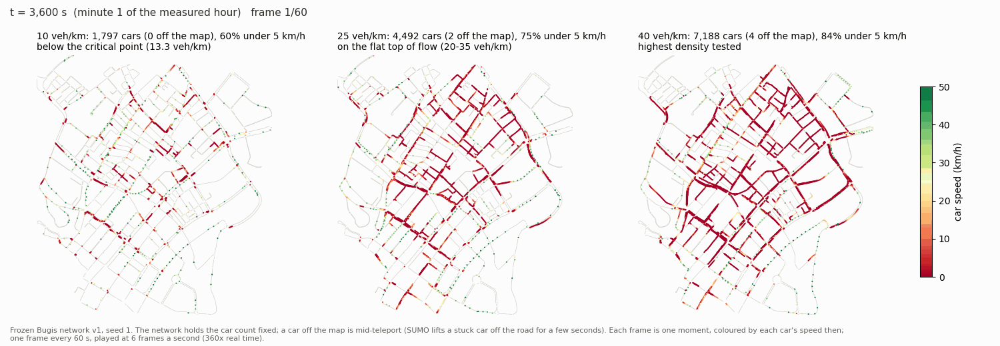

<div align="center">

# Agent-Based Traffic Modeling

**At what density does free-flowing traffic tip into a jam?** We simulate every vehicle, first on a ring road, then on the real road network of Singapore's Bugis district, and then on planning variants of that network.

[**Website**](https://laozhongjie.github.io/agent-based-traffic-modeling/) · [Model explainers](#explore-the-website) · [Reproduce](#reproducing-the-results) · [中文](README_zh.md)

  



<sub>One simulated hour on the Bugis network at 10, 25 and 40 veh/km, each car coloured by its speed. Below the critical point jams stay scattered; at higher density, red jammed roads join across the district.</sub>

</div>

## At a glance

| Scale | Question | Finding |
|---|---|---|
| **Ring road** | Where does free flow break down, and does it behave like a phase transition? | Stop-and-go waves appear above **20–25 veh/km** (NaSch), **25** (OVM) and **30–35** (IDM), with no visible dependence on ring length between 600 and 4800 m. Linear stability analysis places the IDM threshold at 32.9 veh/km. |
| **City network** | Does the Bugis network have a density where throughput peaks, and where does congestion start? | Mean speed halves at **13.3 veh/km per lane**; flow levels off at about **171 veh/h per lane**. This is a smooth crossover, not a critical point. |
| **Planning** | Do closures, lane cuts or new links shift the critical density? Is there a Braess paradox? | Closing the most central removable segment lowers it by **0.45 veh/km (3.4%)**. Other changes stay within seed-to-seed spread, and **no network-wide Braess paradox** appears. |

## What's inside

- **Three car-following models in one pipeline.** NaSch and IDM use SUMO's built-in versions. **OVM is our own C++ model for SUMO**, with a patch and checks against theory.
- **One study at three scales.** A single-lane ring, the Bugis network from OpenStreetMap, and three planning changes to it (a road closure, a lane cut and a new link), all measured the same way.
- **Real data alongside the simulations.** PeMS freeway detectors for the ring results, and 12 days of LTA speed bands from the same district for the city.
- **Reproducible by design.** Each experiment is one TOML file. Every row in `results/` keeps the ID of the run it came from, and any run can be repeated from its config and seed.
- **An interactive bilingual website.** A NaSch ring runs live in the browser, each model has its own page, and all results are shown with their figures, in English and Chinese.

## Explore the website

| Page | What you get |
|---|---|
| [Home](https://laozhongjie.github.io/agent-based-traffic-modeling/) | Live ring demo with a density slider, and all ring, city and planning results |
| [NaSch](https://laozhongjie.github.io/agent-based-traffic-modeling/models/nasch.html) | The four rules, a ring demo and the exact fundamental diagram |
| [OVM](https://laozhongjie.github.io/agent-based-traffic-modeling/models/ovm.html) | The rule, why uniform flow breaks down, and our SUMO implementation |
| [IDM](https://laozhongjie.github.io/agent-based-traffic-modeling/models/idm.html) | The acceleration law, why uniform flow can break down, and SUMO's built-in version |

## Key results in detail

- **Ring road.** Less randomness or faster driver response moves the onset of jams to higher density. Freeway data (PeMS) peak in flow at 19–21 veh/km per lane and show signs of hysteresis.
- **City network.** Neither fluctuations nor recovery time peak at the speed-halving density. Local jams merge into one large cluster between 20 and 25 veh/km. Once traffic load is controlled for, edge betweenness barely predicts where congestion starts.
- **Planning.** A lane cut and a new link both change the critical density by less than the seed-to-seed spread.

## Reproducing the results

```bash
conda env create -f environment.yml
conda activate traffic
```

NaSch and IDM need the official SUMO 1.28.0 release. The C++ OVM needs SUMO 1.28.0 built with the files in `sumo/ovm/` and `sumo/patches/register-ovm.patch` (see `sumo/version.txt`).

```bash
# Model validation
python sumo/check_nasch.py
python sumo/ovm/check_ovm.py
pytest

# City network
python scripts/city_sweep.py    --config configs/city/bugis_all_controller.toml
python scripts/city_measures.py --config configs/city/bugis_all_controller.toml

# Planning scenarios (after sweeping each bugis_all_<variant>_controller.toml)
python scripts/planning_figures.py \
    --extra base=bugis_all_base_controller_seeds4to10 \
    --extra newlink=bugis_all_newlink_controller_seeds4to10
```

The ring-road sweeps use `scripts/ring_sweep.py` with the files in `configs/ring/`. The ring theory and PeMS analyses are in `notebooks/e/`. The SUMO trajectories read by `notebooks/e/model_comparisons.ipynb` (about 150 MB) are kept on the branch `add-critical-density-analysis`. The report's appendix lists every command in full.

## Repository layout

```text
.
├── sumo/                 # Pinned SUMO version, OVM source files, patch, validation checks
├── src/traffic_project/  # Shared Python package: configs, runner, measurements, controller
├── configs/              # One TOML file per experiment (parameters, densities, seeds)
├── scenarios/            # Ring, grid and Bugis networks and the scripts that build them
├── scripts/              # Command-line entry points for sweeps, analyses and figures
├── results/              # Summary tables, time series and figures of all valid runs
├── data/processed/       # Processed external data (LTA speed bands, PeMS stations)
├── notebooks/            # Analysis notebooks of the members
├── tests/                # Automated tests (pytest)
└── docs/                 # Project website (GitHub Pages)
```

Run directories (`runs/`) and raw data are not tracked because of their size. The shared conventions (units, run IDs, checks) are in [GUIDE.md](GUIDE.md).

## Team

| Member | Main work |
|---|---|
| A | Project lead: research plan, shared framework and pipeline, SUMO build and OVM implementation, model validation, website |
| B | Vehicle models; ring-road experiments |
| C | City network: MFD, clusters, spreading and critical-point analyses; LTA data |
| D | Planning scenarios and Braess test |
| E | IDM equilibrium and linear stability; PeMS freeway analysis; discussion |

## Data sources

- Road network: © [OpenStreetMap](https://www.openstreetmap.org/copyright) contributors, ODbL.
- Singapore speed bands: contains information from Traffic Speed Bands accessed from LTA DataMall, made available under the [Singapore Open Data Licence 1.0](https://data.gov.sg/open-data-licence).
- Freeway detector data: Caltrans Performance Measurement System (PeMS).
