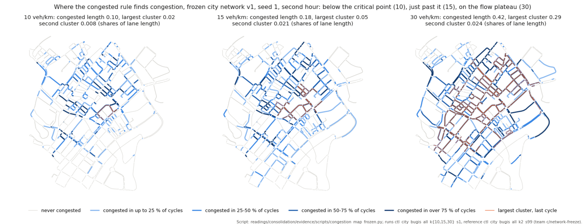

# 道路网络交通拥堵的智能体建模

**畅行的车流，在什么密度下会变成拥堵？** 我们模拟每一辆车：先在环形道路上，再到新加坡武吉士（Bugis）片区的真实路网，最后到这片路网的规划改动。

[**项目网站**](https://laozhongjie.github.io/agent-based-traffic-modeling/) · [模型讲解](#浏览网站) · [复现](#复现结果) · [English](README.md)

  



<sub>Bugis 路网在临界点以下（10 veh/km）、刚过临界点（15）和流量平台上（30）的拥堵分布。红色是最大的连通拥堵团簇。</sub>

## 一览

| 尺度 | 问题 | 结论 |
|---|---|---|
| **环形道路** | 自由流在哪里崩溃？这一转变像不像相变？ | 密度超过 **20–25 veh/km**（NaSch）、**25**（OVM）和 **30–35**（IDM）后出现走走停停波，在 600 到 4800 m 的环路长度范围内看不出差别。线性稳定性分析给出的 IDM 阈值为 32.9 veh/km。 |
| **城市路网** | Bugis 路网是否存在通行量达到峰值的密度？拥堵从哪里开始？ | 平均速度在**每车道 13.3 veh/km** 时减半，流量在**每车道约 171 veh/h** 处趋于平稳。这是平滑过渡，而不是临界点。 |
| **规划** | 封路、减车道或新建道路会不会改变临界密度？是否存在 Braess 悖论？ | 封闭最中心的可封闭路段，使临界密度下降 **0.45 veh/km（3.4%）**。其他改动的影响都在随机种子间的差异之内，**没有发现全网范围的 Braess 悖论**。 |

## 项目内容

- **一条流程，三种跟驰模型。** NaSch 和 IDM 使用 SUMO 内置版本。**OVM 是我们用 C++ 为 SUMO 实现的模型**，附带补丁和对照理论的检验。
- **同一研究，三个尺度。** 单车道环路、来自 OpenStreetMap 的 Bugis 路网，以及对它的三种规划改动（封路、减车道、新建道路），全部用同一套方法测量。
- **模拟之外的真实数据。** 环路结果对照 PeMS 高速公路检测器数据，城市路网对照同一片区 12 天的 LTA 速度等级数据。
- **可复现。** 每个实验一个 TOML 文件。`results/` 中的每一行都记录了来源运行的 ID，每次运行都可以用对应的配置文件和随机种子复现。
- **交互式双语网站。** 浏览器中实时运行的 NaSch 环路、每个模型的讲解页，以及配有图的全部结果，提供中英文两种语言。

## 浏览网站

| 页面 | 内容 |
|---|---|
| [主页](https://laozhongjie.github.io/agent-based-traffic-modeling/) | 可调密度的环路实时演示，以及环路、城市路网和规划情景的全部结果 |
| [NaSch](https://laozhongjie.github.io/agent-based-traffic-modeling/models/nasch.html) | 四条规则、环路演示和精确的基本图 |
| [OVM](https://laozhongjie.github.io/agent-based-traffic-modeling/models/ovm.html) | 模型规则、均匀流为何会失稳，以及我们的 SUMO 实现 |
| [IDM](https://laozhongjie.github.io/agent-based-traffic-modeling/models/idm.html) | 加速度公式、均匀流为何会失稳，以及 SUMO 的内置版本 |

## 结果细节

- **环形道路。** 随机性越小、驾驶员反应越快，拥堵越晚出现。真实高速公路数据（PeMS）的流量峰值出现在每车道 19–21 veh/km，并显示出迟滞迹象。
- **城市路网。** 涨落和恢复时间在速度减半的密度处都没有峰值。局部拥堵在 20 到 25 veh/km 之间合并成一个大团簇。控制交通负载后，边介数几乎无法预测拥堵从哪里开始。
- **规划。** 车道缩减和新建道路带来的临界密度变化，都小于不同随机种子之间的差异。

## 复现结果

```bash
conda env create -f environment.yml
conda activate traffic
```

NaSch 和 IDM 只需要官方 SUMO 1.28.0。C++ 版 OVM 需要用 `sumo/ovm/` 中的文件和 `sumo/patches/register-ovm.patch` 构建 SUMO 1.28.0（见 `sumo/version.txt`）。

```bash
# 模型验证
python sumo/check_nasch.py
python sumo/ovm/check_ovm.py
pytest

# 城市路网
python scripts/city_sweep.py    --config configs/city/bugis_all_controller.toml
python scripts/city_measures.py --config configs/city/bugis_all_controller.toml

# 规划情景（先分别运行各个 bugis_all_<variant>_controller.toml）
python scripts/planning_figures.py \
    --extra base=bugis_all_base_controller_seeds4to10 \
    --extra newlink=bugis_all_newlink_controller_seeds4to10
```

环形道路的扫描使用 `scripts/ring_sweep.py` 和 `configs/ring/` 中的配置文件，环路理论和 PeMS 分析在 `notebooks/e/` 中。`notebooks/e/model_comparisons.ipynb` 读取的 SUMO 轨迹（约 150 MB）保留在分支 `add-critical-density-analysis` 上。完整命令见报告附录。

## 仓库结构

```text
.
├── sumo/                 # 固定的 SUMO 版本、OVM 源文件、补丁和验证脚本
├── src/traffic_project/  # 共享 Python 包：配置、运行、测量、密度控制器
├── configs/              # 每个实验一个 TOML 文件（参数、密度、随机种子）
├── scenarios/            # 环路、网格和 Bugis 路网，以及生成它们的脚本
├── scripts/              # 扫描、分析和作图的命令行入口
├── results/              # 所有有效运行的汇总表、时间序列和图
├── data/processed/       # 处理后的外部数据（LTA 速度带、PeMS 站点）
├── notebooks/            # 组员的分析 notebook
├── tests/                # 自动化测试（pytest）
└── docs/                 # 项目网站（GitHub Pages）
```

运行目录（`runs/`）和原始数据体积较大，没有纳入 Git。共享约定（单位、运行 ID、检查）见 [GUIDE_zh.md](GUIDE_zh.md)。

## 团队

| 成员 | 主要工作 |
|---|---|
| A | 项目负责人：研究方案、共享框架与实验流程、SUMO 构建与 OVM 实现、模型验证、项目网站 |
| B | 车辆模型；环形道路实验 |
| C | 城市路网：MFD、拥堵团簇、扩散与临界点分析；LTA 数据 |
| D | 规划情景与 Braess 检验 |
| E | IDM 平衡态与线性稳定性；PeMS 高速公路数据分析；讨论 |

## 数据来源

- 道路网络：© [OpenStreetMap](https://www.openstreetmap.org/copyright) 贡献者，ODbL 许可。
- 新加坡速度带：包含来自 LTA DataMall 的 Traffic Speed Bands 信息，依据[新加坡开放数据许可 1.0](https://data.gov.sg/open-data-licence) 提供。
- 高速公路检测器数据：加州交通局性能测量系统（PeMS）。
